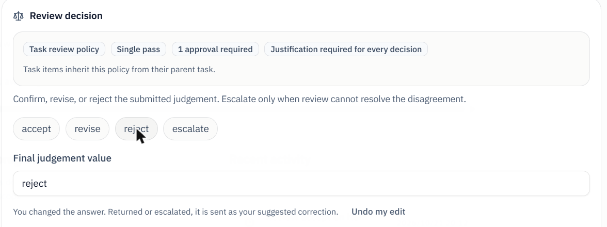
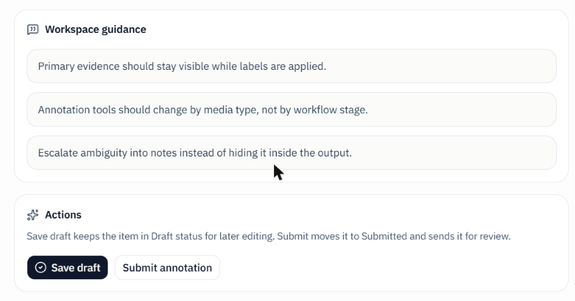
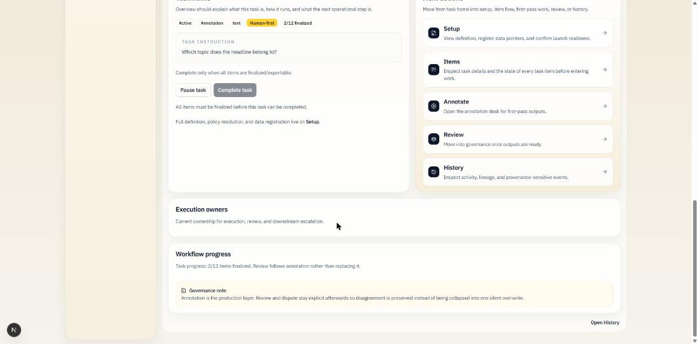
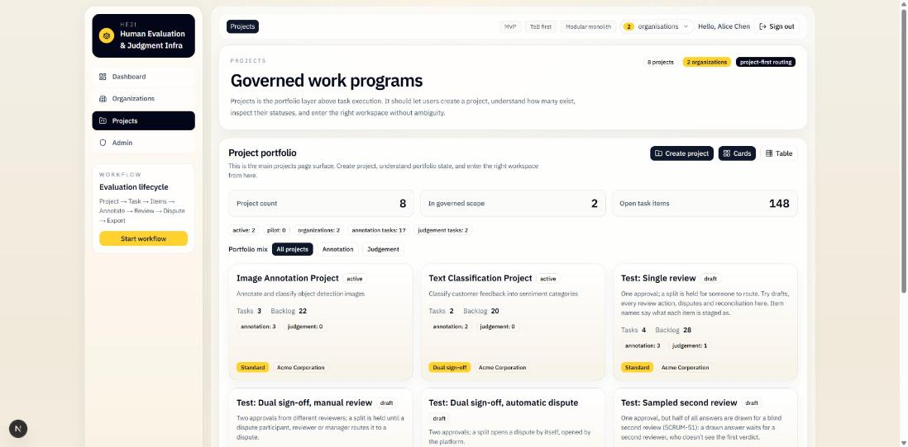
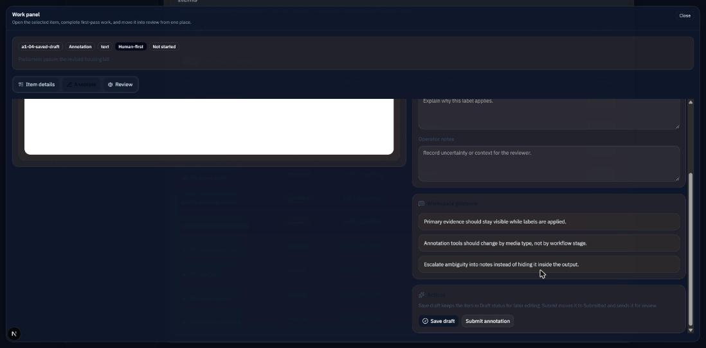

# Frontend design review — removing what distracts (hej-web, `main` at `f3dfdc1c`)

**Scope.** This is not a redesign. The layout, palette, cards and tabs stay as they are. The review looks for
things to *remove*: button styles that say the wrong thing, helper text nobody needs, and information shown
several times over. Every recommendation is a deletion, or a swap to a variant that already exists in
`packages/ui`.

**Why it needs this document.** `mission.md` says UI style may change only "with written justification agreed
at review". This file is that justification, item by item, so a declutter PR can point here instead of
arguing each change in review.

**How it was checked.**

- `main` at `f3dfdc1c` (PR #80 merged), the web app run against a throwaway SQLite database seeded by
  `init_data.py`. No shared development database was touched. Signed in as Alice (administrator), Chrome at
  1440 px wide.
- Pages walked: login, Dashboard, Projects, one project's Overview, one task's Overview, Annotate, Review and
  Dispute, the item work panel (annotate and review tabs), and a dispute case.
- For D1, every page was scanned again in dark mode with a contrast script
  ([`frontend-review/contrast-scan.js`](frontend-review/contrast-scan.js)), with a light-mode control run.
- The source was searched for the same patterns across all 148 non-test `.tsx` files. Every finding below gives the
  file and line.
- The lens is Anthropic's `frontend-design` skill (installed at `~/.claude/skills/frontend-design`). The
  parts used: "visual structure is information", "let each written element do exactly one job", "a CTA says
  exactly what happens", and "remove one accessory".

**Before you remove anything:** no test asserts any of the text below. The work-panel tests find buttons by
name ("Save draft", "Submit annotation"), so they keep passing when a variant changes. The only open PR that
touches an affected file is #89 (`project-create-form.tsx`, finding B2).

---

## Summary

| # | Finding | Kind | Severity | Effort |
| --- | --- | --- | --- | --- |
| 0 | In judgement review, the lowercase chips `accept / revise / reject / escalate` overwrite the reviewer's verdict with that word | **Correctness** | High | Small |
| A1 | "Save draft" is the primary button and "Submit" is secondary | Button | High | Trivial |
| A2 | Every review decision has two sets of controls: chips at the top and buttons at the bottom | Button | High | Small |
| A3 | The primary colour is hand-painted on about 50 buttons; 35 of them break in dark mode | Button | Medium | Small, mechanical |
| A4 | The view toggles and filter chips look exactly like primary actions | Button | Medium | Small |
| A5 | Destructive actions look four different ways; `variant="destructive"` is never used | Button | Medium | Small |
| A6 | A disabled "Complete task" is louder than the enabled "Pause task" | Button | Low | Trivial |
| A7 | The sidebar's amber "Start workflow" button on every page only links to Projects | Button | Low | Trivial |
| A8 | The Actions heading uses a sparkles icon, which reads as "AI", and Save draft uses a check icon | Button | Low | Trivial |
| A9 | The Review desk's Review button sits behind a horizontal scroll at 1440 px | Button | Medium | Small |
| B1 | Design-brief sentences are shipped as UI copy | Helper text | High | Small |
| B2 | Internal vocabulary shows on screen: `MVP`, `Modular monolith`, `backend id`, raw enums | Helper text | Medium | Small |
| B3 | Static "guidance" and "governance" boxes repeat principles on every item | Helper text | Medium | Trivial |
| B4 | Buttons come with a sentence that explains them | Helper text | Low | Trivial |
| B5 | The login page says the same two sentences twice | Helper text | Low | Trivial |
| C1 | Task Overview shows the same status counts four times | Duplication | Medium | Small |
| C2 | "Next actions", "Workspace guidance" and "Project side surfaces" duplicate the tab bar | Duplication | Medium | Small |
| C3 | "Execution owners" is always empty, and assignment does not exist in this product | Duplication | Medium | Trivial |
| C4 | The Dashboard is mostly scaffold copy, with a hard-coded "Canonical Decisions 0" | Duplication | **High** for the demo | Small |
| C5 | Each figure on the Projects header appears in three places | Duplication | Low | Trivial |
| D1 | Dark mode follows the system and the `d` key; in it, 29% of all text is below 3:1 contrast on 14 of 18 pages, including the controls on Annotate and History | Theme | **High** | Three lines |

**If there is time for only five changes:** 0, D1, A1, C4 and B1. Finding 0 is a real bug. D1 makes most
working screens unreadable for anyone whose OS is in dark mode, and the fix is three lines. A1 is the most-used
screen in the product. C4 and B1 are what the client sees first in the demo (K4).

---

## 0 — Correctness: the judgement-review chips overwrite the verdict

This is not about style. It surfaced during the button audit and should be fixed first.

**Where:** [`task-item-workspace-sheet.tsx:3905-3916`](../../../hej/apps/hej-web/components/task-item-workspace-sheet.tsx)
(judgement review) and `:4263-4274` (annotation review).

**What happens:** each chip calls `setReviewVerdict(action)`. On a judgement task, `reviewVerdict` is the
**Final judgement value** field directly below the chips. The value sent as `final_verdict` (`:2222`) and as
the optimistic `canonicalVerdict` on Accept (`:2320`) is that field.

**Reproduced** on item `a3-04-awaiting-review` in "1 submission per item: judgement", without submitting. The
field held the annotator's verdict, `accurate`. Clicking the `reject` chip changed it to `reject`, and
"You changed the answer… it is sent as your suggested correction" appeared. A reviewer who clicks `reject`
and then the **Reject** button sends a correction whose verdict is the literal string `"reject"`. *(Corrected
2026-10-21.)* On a task that defines labels, as every seeded judgement task does, the backend refuses that
correction (`review_actions.py:700`, since #61). The reviewer gets a 422 naming a value they never typed. On
a judgement task with no labels, nothing refuses it, and since SCRUM-124 an expert can accept the correction,
so the string can become the canonical answer.

On annotation tasks the chips write to `reviewVerdict` too, but `final_verdict` is sent only for judgements.
There they do nothing at all, which is finding A2.

**Remove** both chip rows. The buttons under **Actions** are the decision.

---

## A — Buttons

### A1. Save draft is primary and Submit is secondary

[`task-item-workspace-sheet.tsx:3076`](../../../hej/apps/hej-web/components/task-item-workspace-sheet.tsx)
(judgement) and `:3547` (annotation): "Save draft" is the filled dark button with a check icon. "Submit
judgement" or "Submit annotation" is an outline. Submitting is the step that moves work forward. Saving is
the fallback. As it stands, the eye goes to the wrong button, and the check icon suggests "done".

**Change:** make Submit the default variant and Save draft the outline, and drop the `CheckCircle2` icon.

### A2. Two sets of controls for one review decision

The review tab shows `accept · adjust · reject · escalate` as rounded lowercase chips under the heading,
then **Accept · Adjust · Reject · Escalate** as buttons at the bottom. The chips look clickable, and nothing
on screen shows they are selected (finding 0 covers what they actually do). **Remove the chips**, since the
buttons already carry the decision. The same fix as finding 0.

### A3. The primary colour is hand-painted on about 50 buttons

`--primary` is already `oklch(0.205 0 0)`, near-black, and inverts in dark mode
(`packages/ui/src/styles/globals.css:17,52`). Even so, buttons override it by hand:

- **35 buttons** use `bg-slate-900 text-stone-100` (or `bg-slate-950`) **with no `dark:` variant**. They
  stay dark-on-dark in dark mode, while the 10 that do have one invert. Examples:
  `task-item-workspace-sheet.tsx:3077`, `task-create-form.tsx:1520,1529`,
  `task-dataset-registration-panel.tsx:778,940,1090,1185`, `project-task-table.tsx:140`.
- **One-off colours** with no meaning anyone has documented: green "create" at
  `admin-org-member-create-dialog.tsx:215`, blue at `protocol-judgement-steps.tsx:351`, amber at
  `app-shell.tsx:256` and `dashboard-hero.tsx:35`, and custom drop shadows at `history-drawer.tsx:148` and
  `model-run-drawer.tsx:220`.

In light mode these overrides add nothing, and in dark mode they break. **Change:** delete the colour classes
from `className` and let `variant="default"` do the work. This is a mechanical find-and-delete, with no
visual change in light mode except the blue, green and amber one-offs.

### A4. Toggles and filters look like primary actions

On Projects, the **Cards / Table** view toggle paints the active option with the same dark fill as **Create
project** beside it (`projects-overview-panel.tsx:81,90`). Three dark buttons in a row, and only one of them
creates anything. The Annotate table's group chips (`Draft`, `Returned`, `Rejected`) do the same. **Change:**
active toggle = `variant="secondary"` with `aria-pressed`, so dark fill always means "this does something".

### A5. Destructive actions look four different ways

`variant="destructive"` exists in `packages/ui` and is used **0 times**. Instead:

- solid rose: remove a member, `admin-org-member-remove-dialog.tsx:98` and `admin-membership-table.tsx:126`;
- outline, the same as a neutral action: Archive project at `project-settings-sheet.tsx:190`, Reject in
  review at `task-item-workspace-sheet.tsx:4037,4416`, remove a span at `text-span-annotator.tsx:517`;
- ghost with red text: remove a file at `task-dataset-registration-panel.tsx:764,923`;
- the "reject" chips (A2).

In review, Reject looks exactly like Adjust and Escalate. **Change:** use `variant="destructive"` on the
confirming destructive buttons (Remove, Archive, Reject), and leave Escalate and Adjust as outline.

### A6. Disabled "Complete task" draws more attention than enabled "Pause task"

On task Overview, the disabled primary renders as a solid grey block next to a white "Pause task". Two
sentences explain it: "Complete only when all items are finalized/exportable." (`task-overview-panel.tsx:277`)
and "All items must be finalized before this task can be completed." (`:370`). **Change:** keep one sentence,
the second, and render Complete as outline while disabled.

### A7. The sidebar's "Start workflow" card

Every page carries a sidebar card with a "WORKFLOW" eyebrow, "Evaluation lifecycle",
`Project → Task → Items → Annotate → Review → Dispute → Export` and an amber **Start workflow** button that
links to `/projects` (`app-shell.tsx:246-258`). It is the brightest element on every screen, and it repeats
the **Projects** link four lines above it. **Remove** the card.

### A8. Icons that mean something else

The **Actions** heading in the work panel uses `Sparkles` (`task-item-workspace-sheet.tsx`, both Actions
blocks). In a product where AI suggestions are a first-class object, sparkles reads as "AI does this". The
check icon on Save draft is covered in A1. **Remove** both icons.

### A9. The row action sits behind a horizontal scroll

On the Review desk at 1440 px, the **Review** button in the last column is cut off and needs the table
scrolled sideways. It is the only thing a reviewer comes to that table to do. The Dispute desk is the same
on narrower screens. Two columns take the room and say nothing: **Mode** repeats the task's mode on every
row, and **Annotated output / Draft output** shows the payload's *modality*, which is `unknown` on every
seeded row (`lib/annotation-contract.ts:216`). **Remove** both columns; the action then fits.

---

## B — Helper text

### B1. Design-brief sentences shipped as UI copy

These read as notes from the person who designed the screen, not text for the person using it. **Delete
each one.** None of them carries information the heading does not.

| Screen | Text on screen | Source |
| --- | --- | --- |
| Projects | "Projects is the portfolio layer above task execution. It should let users create a project, understand how many exist…" | `projects-overview-read-path.tsx:40` |
| Projects | "This is the main projects page surface. Create project, understand portfolio state…" | `projects-overview-panel.tsx:67` |
| Project | "This section shows a compact preview of tasks, not the full list…" | `project-workspace-overview.tsx:204` |
| Project | "These stay in project scope because they cut across tasks or express governance ownership." | `project-workspace-overview.tsx:321` |
| Project | "Policy visibility stays at project scope so task setup remains governed but not overloaded." | `project-workspace-overview.tsx:340` |
| Project | "Project overview should push operators toward task execution first…" | `project-workspace-overview.tsx:373` |
| Task | "Overview should explain what this task is, how it runs, and what the next operational step is." | `task-overview-panel.tsx:249` |
| Task | "Human-first annotation task. Configure launch settings, inspect task items, complete first-pass work…" (subtitle on every task tab) | `task-workspace-client-shell.tsx:96` |
| Review desk | "Task-level ownership stays visible here instead of living inside the item console." | `task-workbench.tsx:416` |
| Review desk | "Task-level events stay outside the work panel." | `task-workbench.tsx:494` |
| Work panel | "A media-first annotation surface would live here. For MVP this stays a structured mock, but this is the slot that could later host Label Studio…" | `task-item-workspace-sheet.tsx:3116` |
| Work panel | "Review uses the same evidence pane as annotation, but the reviewer edits or confirms…" | `task-item-workspace-sheet.tsx:4073` |
| Dashboard | "This frontend mirrors the project canon…", "This screen was laid out against the project docs…" | `dashboard-hero.tsx:29`, `dashboard-workflow-process.tsx:95` |

The work-panel line is the worst of these. It tells an annotator, while they work, that the screen is a
mock, and it names Label Studio, which is a non-goal in `mission.md`.

### B2. Internal vocabulary on screen

- Header chips **MVP · ToB first · Modular monolith** (`app-shell.tsx:289-296`) on every page wider than
  1536 px. They describe the architecture, not anything the user can act on. **Remove.**
- **"project-first routing"** chip on Projects (`projects-overview-read-path.tsx:50`). **Remove.**
- "Project … · backend id …" (`task-create-form.tsx:1609`), "Loading **live** organizations…"
  (`project-create-form.tsx:317`, `organizations/page.tsx:266`), "Sign in to load organization policy from
  the **backend**" (`admin-governance-panel.tsx:183`), "No **backend** task has been selected for this
  dashboard preview" (`task-launchpad.tsx:84`), "**MVP** cannot resolve s3:// in Annotate"
  (`task-dataset-registration-panel.tsx:1175`). **Remove "backend" and "live"**, and drop the id. `#89` also
  edits `project-create-form.tsx`, so leave that one line to its author.
- Raw enum values as badges: `human_first` on project task cards, and `needs_revision`, `escalate`,
  `trigger` on a dispute case. Elsewhere the same values are formatted ("Human-first"). **Use the existing
  formatters.**

### B3. Static guidance boxes

Three bordered boxes in the work panel repeat fixed sentences on every item. They are design principles,
not instructions:

- **Workspace guidance**: "Primary evidence should stay visible while labels are applied.", "Annotation
  tools should change by media type, not by workflow stage." (`task-item-workspace-sheet.tsx:3515`)
- **Governance checks**: "The final payload follows the task schema, not reviewer shorthand." … (`:3988`,
  `:4368`)
- **Reviewer focus**: "Confirm label boundaries, object extents, or media timestamps…" (`:4165`), shown on a
  text-classification task, where none of those exist.

Two more sit on the task pages: **Governance note**, "Annotation is the production layer…"
(`task-side-panels.tsx:136`), and "Review and dispute remain explicit…" (`task-workbench.tsx:480`). The
project page has **Workspace guidance** (`project-workspace-overview.tsx:407`). **Remove all six.**

### B4. A sentence that explains the button next to it

- "Save draft keeps the item in Draft status for later editing. Submit moves it to Submitted and sends it
  for review." (`task-item-workspace-sheet.tsx:3070,3541`). The button names already say this. **Remove.**
- "Task items inherit this policy from their parent task." under the review policy badges (`:3894,4257`).
  **Remove.**
- "Full definition, policy resolution, and data registration live on Setup." (`task-overview-panel.tsx:378`).
  Setup is a tab one inch above. **Remove.**
- The Complete task pair is covered in A6.

### B5. The login page says everything twice

The left panel and the sign-in card both say "Use your workspace credentials to access projects, tasks,
and governance views." (`app/login/page.tsx:28`, `login-form.tsx:58`). Both also say "Need access? Contact
your workspace administrator." (`page.tsx:37`, `login-form.tsx:120`). The left panel adds a third line,
"Sign in with your workspace account to continue into the projects and tasks experience." **Keep the card's
copy and remove the left panel's three paragraphs.**

---

## C — Information shown more than once

### C1. Task Overview shows the counts four times

Task Overview shows the same twelve items as:

1. four stat cards (Total, In draft, Finalized, Needs attention);
2. a sentence, "4 in draft · 1 awaiting review · 3 returned…";
3. a "Task phase pipeline" row (Annotation 4, Review 5, Dispute 1, Final 2);
4. an "Item lifecycle" bar with eight cards and percentages.

Then the "Workflow progress" card says "2/12 items finalized" again. Annotate repeats this pattern: stat
cards, then the same groups as an "Annotate queue" breakdown. **Keep** the stat cards and the lifecycle bar.
**Remove** the sentence, the pipeline row and Workflow progress.

### C2. Navigation repeated under the tabs

The tab bar (Overview · Setup · Items · Annotate · Review · Dispute · Reconciliation · Finalized · History)
is always visible. Below it, Task Overview adds **Next actions** (Setup, Items, Annotate, Review, History,
each with a description, at `task-overview-panel.tsx:396`) and an **Open History** link. Project Overview
adds **Project side surfaces** (Disputes, Exports, Policies), **Next actions** (five more links), **Workspace
guidance** (four sentences describing the tabs) and a **Task portfolio snapshot**, which previews three
tasks and says "the full list lives in Task portfolio". **Remove** all of these.

### C3. "Execution owners" is always empty

The card appears on Task Overview (`task-side-panels.tsx:44`) and the Review desk (`task-workbench.tsx:413`).
It shows a heading, a description and nothing else, because `assignments` is always `[]`
(`lib/task-workspace-data.ts:856`). By the client's decision of 2026-09-17 there is no assignment in this
product, so the card describes something that will never exist. **Remove** both instances.

### C4. The Dashboard is the scaffold's landing page

The first screen after sign-in, and the first screen of the demo, is almost all scaffold copy: the "MVP
scaffold" badge, "This frontend mirrors the project canon", **Product structure**, **Shared core reminder**
("The frontend is now organized the same way the backend should be organized…"), **Workflow process** and
**Document alignment**. Two parts are *wrong*, not just noisy:

- **"Canonical Decisions 0"** is hard-coded (`dashboard-home-read-path.tsx:54`, `canonicalDecisionCount={0}`).
  The seeded database has canonical answers, three in one project alone. A project manager "needs to trust
  every number the platform shows them" (`mission.md`).
- **Workflow process** labels Review and dispute, Canonical export and the others as `SCAFFOLDED`, and
  Dataset registration as `M1 LIVE` (`dashboard-workflow-process.tsx:17-35`). All of them are built. It
  also says annotation is routed "into Label Studio".

The **Task launchpad** shows a fake "AI-assisted" preview with "Backend task required" fields
(`task-launchpad.tsx`).

**Change:** keep the three true stat tiles (Organizations, Projects, Tasks). Drop the canonical tile, or
wire it to real data. Remove the hero copy, launchpad, product structure, shared core reminder, workflow
process and document alignment. What remains is a short page that links into Projects. That is honest, and
better for the demo than a page describing the platform as a scaffold.

### C5. The Projects header says each figure three times

"8 projects" and "2 organizations" appear as chips in the header, again as the stat cards **Project count
8** and **In governed scope 2**, and again in a third chip row: `active: 2 · pilot: 0 · organizations: 2 ·
annotation tasks: 17 · judgement tasks: 2`. **Keep** the stat cards and **remove** both chip rows.

---

## D — Theme

### D1. Dark mode is reachable, and most working screens are unreadable in it

**How anyone ends up in it.** `ThemeProvider` uses `defaultTheme="system"`, and a global `d` hotkey toggles
the theme from anywhere outside an input (`theme-provider.tsx`). Anyone whose OS is set to dark gets it on
first load. Anyone who presses `d` while reading a page, as a keyboard user easily might, flips the whole
app.

**What was measured.** Every page was loaded in dark mode and run through a contrast scan
([`frontend-review/contrast-scan.js`](frontend-review/contrast-scan.js)). The scan compares each piece of
text with the background actually behind it, and counts the pieces below **3:1**. That is the WCAG AA
minimum even for large text; normal text needs 4.5:1, so the figures below are conservative. A ratio near
**1:1** means the text is the same colour as its background, so it is invisible, not just faint.

| Page (dark mode) | Text below 3:1 | Of which inside buttons or tabs | Worst examples |
| --- | --- | --- | --- |
| Project · Policies | **200 of 304** | 0 of 15 | "Custom policy" 1.11; policy rows 1.15 |
| Project · Overview | **63 of 163** | 1 of 6 | the task-card badges ("active", "Annotation", "text") 1.13 |
| Task · Overview | **45 of 102** | 1 of 5 | "Governance note" 1.02; "Next actions" 1.24; the task instruction 1.27 |
| Task · Setup | 40 of 115 | 1 of 16 | the policy summary 1.15 |
| Task · History | 35 of 89 | **26 of 46** | step names 1.10–1.30 |
| Project · Exports | 25 of 68 | 0 of 8 | the format column ("jsonl") 1.01 |
| Project · Disputes | 24 of 69 | 1 of 12 | task names and deciders 1.01 |
| Project · Tasks | 23 of 88 | 0 of 15 | the stat-card labels 1.39 |
| Task · Review | 23 of 78 | 0 of 10 | the Review desk's text 1.40 |
| Admin | 20 of 185 | 0 of 36 | "Tenant-level governance…" 1.39 |
| Task · Annotate | 16 of 76 | **13 of 23** | the queue-group cards (Returned, Rejected, Disputed…) 1.40 |
| Task · Items | 14 of 139 | 0 of 34 | 1.39 |
| Task · Finalized | 10 of 48 | 0 of 6 | **the error message** "Could not load finalized…" 1.25 |
| Task · Dispute | 6 of 78 | 0 of 9 | 1.40 |
| Task · Reconciliation | 3 of 51 | 0 of 6 | 1.40 |
| Work panel, annotate tab | 13 of 32 | 1 of 6 | the headings (Text annotation workspace, Output schema, Actions) 1.13; the selected tab "Annotate" 1.20; the item text and field labels 1.52 |
| Dashboard, Organizations, Projects, Login | 0 | 0 | — |

**In total, 547 of 1,891 pieces of text (29%) fall below 3:1** across the 18 pages, and 14 of the 18
are affected. The four clean pages are the ones the user sees first. The damage starts at the first
click into a project. On the two screens where people do the work, it reaches the controls: 13 of the 23
button and tab labels on Annotate and 26 of 46 on History. In the work panel, **Save draft**'s dark fill
is 1.13:1 against its card, so the button has no visible edge.

**Control run.** In light mode, the same scan on six of these pages found 3 pieces of text out of 515 below
3:1 (all on Task Overview). The problem belongs to dark mode, not to the scan.

**Why, in the code.** Two causes, both repeated across the app:

1. **Dark text with no dark variant.** 362 `className`s set `text-slate-700/800/900/950` with no
   `dark:text-…` (74 of them in `task-item-workspace-sheet.tsx`, 26 in `dispute-case-detail.tsx`, 24 in
   `task-create-form.tsx`). On a dark surface they come out at 1.0–1.3:1. These are the invisible headings.
2. **Light surfaces the dark bridge does not reach.** `packages/ui/src/styles/globals.css` has a "bridge"
   that darkens some hard-coded light backgrounds in dark mode, but only for a fixed list: `bg-white/58`
   to `/94` and `bg-stone-50/100`. Plain `bg-white` (49 uses with no `dark:bg-`), `bg-white/70`,
   `bg-white/95` and others stay light. When text on them *does* switch to its light `dark:` colour, it
   lands at about 1.4:1. These are the status cards on Annotate and the Review desk.

The bridge shows that someone started on dark mode, but it covers backgrounds and borders, not text, so
the work is roughly half done.

**Not measured.** The review tab of the work panel, the dispute-case dialog and the blind-then-reveal
steps could not be opened in this run (a second backend began answering on port 8000 partway through).
They use the same heading classes as the annotate tab (`text-slate-900`, no `dark:` variant), so expect
the same result. The figures come from seeded data at 1440 px. A page holding more rows has more
unreadable text, not less.

**Change.** Finishing dark mode means touching several hundred class lists, which is a redesign and out of
scope for W11. **Remove it for now:** set `defaultTheme="light"` and `enableSystem={false}` in
`theme-provider.tsx` and drop the `d` hotkey. That is three lines. Nobody meets an unreadable screen in
the demo, and the bridge stays in place for whoever finishes dark mode later. After the change, rerun
`contrast-scan.js` with the OS set to dark: every page should match the light-mode figures.

---

## What this review deliberately leaves alone

- **Finishing dark mode.** D1 switches it off; fixing it is the several-hundred-class job described there.
- **The visual identity** (cream background, amber accent, rounded cards, soft shadows). The
  `frontend-design` skill would call it the generic "SaaS card kit", but `mission.md` keeps working UI style
  stable, and with build work ending 28 Oct there is no time to redesign it.
- **Wording that carries rules**: the blind-then-reveal copy (`protocol-judgement-steps.tsx`), the dispute
  eligibility lines ("Only an expert who took no part in this item's work can decide this case"), the
  release notes in `task-releases-section.tsx`, and the justification requirements under the review fields.
  Each of these tells the user something the screen enforces.
- **Review history inside the work panel.** It overlaps the History drawer, but a reviewer needs it next
  to the item.
- **The status vocabulary** ("Canonicalized", "Expert send-back" and the like): that is A5's question, a
  story set aside.

## Suggested way to land it

One PR, "UI declutter", in four commits that can each be reviewed on its own:

1. **Finding 0 and A2:** remove both chip rows. Add one test: in judgement review, the verdict field keeps
   the annotator's value until the reviewer types.
2. **A1, A3–A8:** variant swaps and `className` colour deletions. No behaviour change, and the existing
   tests should pass unchanged.
3. **B1–B5:** text deletions.
4. **C1–C5, A9 and D1:** panel, column and theme removals. The test impact is limited to snapshot-free
   render tests of `task-overview-panel`, `project-workspace-overview` and `dashboard-home-read-path`, if
   any assert those headings. None were found by searching.

No ticket covers this today. It fits as preparation for the demonstration (K4), or as a small W11 ticket.
Finding 0 is a defect in SCRUM-124's correction path and can be raised on its own.
