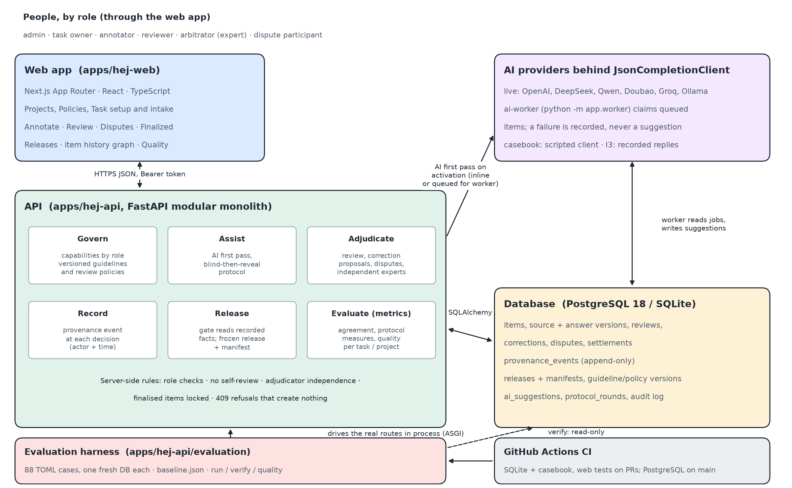
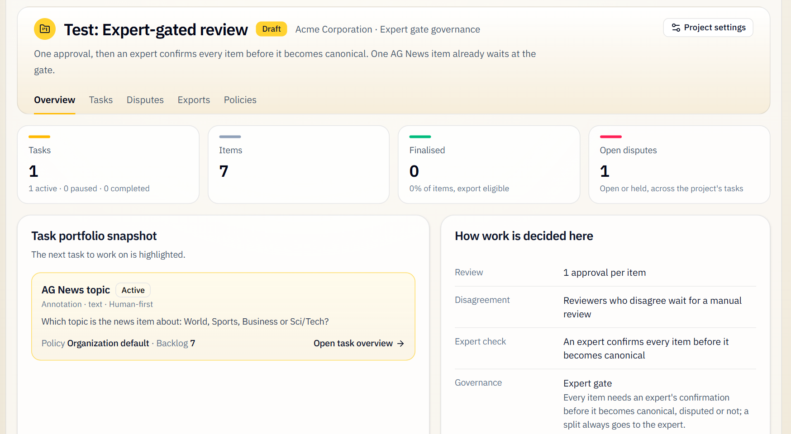
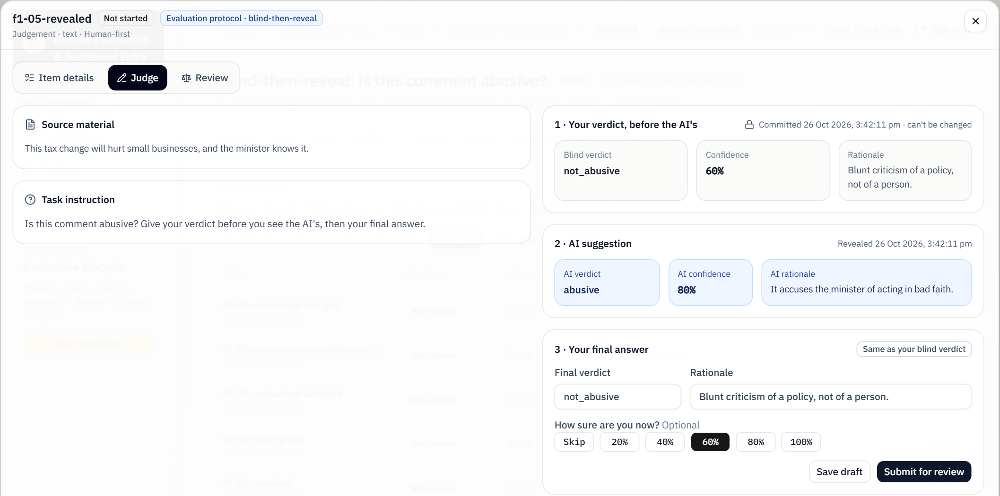
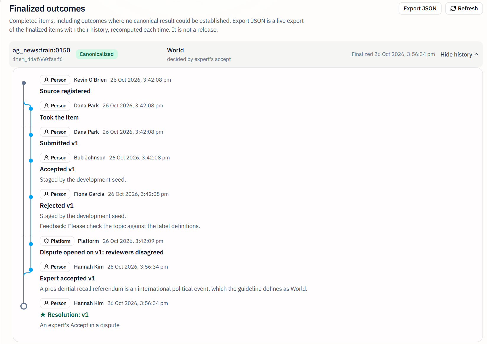
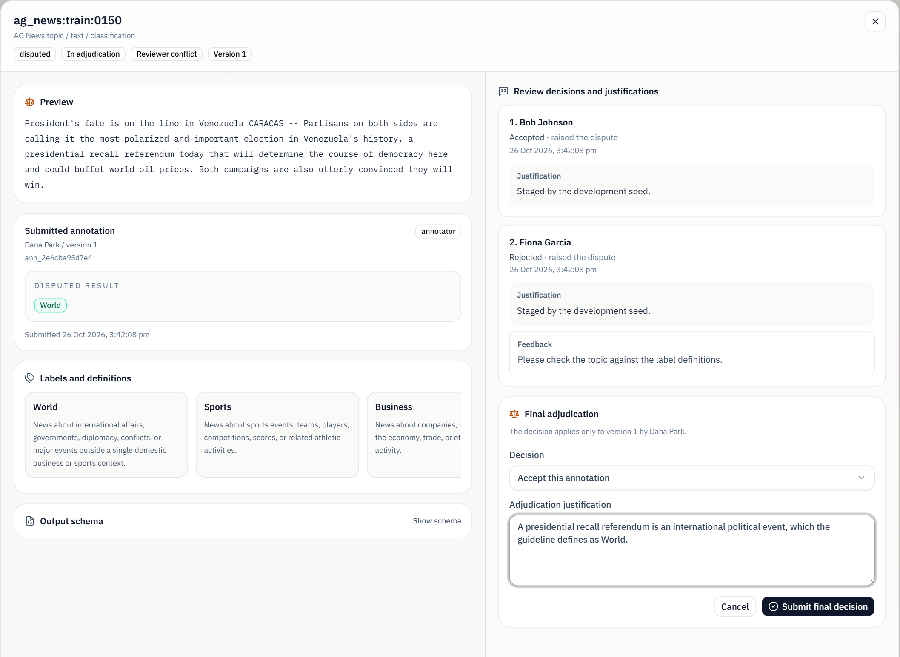
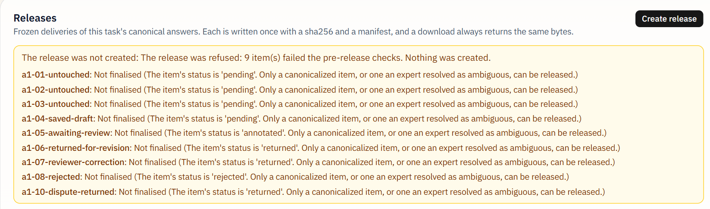
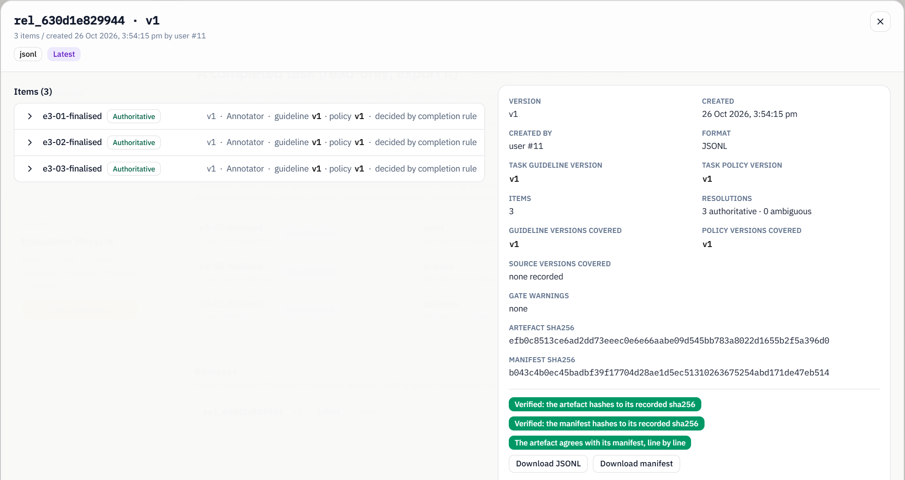

# 7 Results

This chapter reports what the team built and what it was measured to do: the prototype as a system (Section 7.1), the six pillars of the brief with the rules the server enforces (Section 7.2), the quantitative results (Section 7.3), and an answer to each project question of Section 3.2 (Section 7.4).

Unless a source is named, every figure was measured by the team on 26 October 2026 on `main` of the `USYD-CS-Capstone/hej` repository at commit `6951781`, in a clean worktree, on Windows 11 with Python 3.14.7 and Node 22.23.2. Tests ran on in-memory SQLite; screenshots were taken from the running application on a freshly seeded SQLite database. No live model was called: AI answers came from the casebook's scripted client and from model replies recorded earlier and committed to the repository.

## 7.1 The prototype system

**What was built.** Hej is a web platform in which an organisation runs annotation projects whose output it can defend. Its architecture is shown in Figure 1. People work through a Next.js web application, which calls a FastAPI service over JSON with a bearer token. The service is a modular monolith: the routes for each pillar call a shared service layer, and every governance rule (who may act, on what, and when) is checked there rather than in the browser. Data is held in PostgreSQL 18 in CI and production configuration, with SQLite as an explicit fallback for local work. AI suggestions are produced either inline when a task is activated or by a separate worker process that claims queued items, and every provider is reached through one typed interface, `JsonCompletionClient`; six OpenAI-compatible providers are configured (OpenAI, DeepSeek, Qwen, Doubao, Groq and Ollama). The evaluation harness sits beside the API: it drives the real routes in process, builds a fresh database for each case, and can also open any database read-only to check its integrity. GitHub Actions runs the backend suite and casebook on SQLite and the web checks on every ready pull request, and repeats the backend suite on PostgreSQL after each merge to `main`.

**What it does, end to end.** A task owner creates a project under one of four governance postures (Standard, Dual sign-off, Expert-gated, Arbitration-ready), creates a task with its own labels and guideline, and registers items, for example from a JSON Lines file with one source record per item. On activation the task runs human-first or AI-first. Annotators take items from self-served queues; reviewers accept, adjust, reject or escalate; a split between reviewers is held, settled by an independent reviewer or opened as a dispute, depending on the posture; an expert decides disputes and, under the Expert Gate, confirms every item. A finalised item has one authoritative answer or is resolved as ambiguous, and a release freezes a task's finalised items with a manifest.

**How it was developed and shown to the client.** The platform was built on the inherited codebase in weekly sprints from week 6 to week 11 (Chapters 4 and 6), as 63 user stories delivered through reviewed pull requests, with design decisions recorded in 25 architecture decision records (ADRs). The client saw the working application at the weekly meetings; on 21 October, for example, the team demonstrated "who decides", "what gets released" and "what we can measure" live on seeded databases. That feedback changed the product: after the client observed that an administrator may lack the domain expertise to judge the work, administrators lost every judging capability (ADR 023), and cases EV-131 and EV-132 now prove that administrators and task owners can run and release work but cannot judge it. The seed data handed over includes eleven demo accounts and ten test projects, four of them on real AG News and Civil Comments records from the client's dataset package.

## 7.2 Results by pillar

### 7.2.1 Govern

Six organisation roles (admin, task owner, annotator, reviewer, arbitrator, dispute participant) map onto nine capabilities grouped by the authority they need: governing, configuring, overseeing, releasing and the four judging capabilities (annotate, review, dispute, adjudicate). Administrators and task owners configure, oversee and release but cannot judge (ADR 023). Guidelines and review policies are versioned: an edit creates a new version, new work follows it, and each answer records the versions it was given under (ADR 018). Figure 2 shows the project overview stating, in plain language, the rules in force under the Expert Gate posture.

The rules are enforced by the API, not by hiding buttons: in the walkthrough, an annotator who opened an item's Review tab received the server's refusal for want of the reviewer role. Permission suites call the routes as real users, and casebook cases prove each refusal end to end (Section 7.3.1).

### 7.2.2 Assist

AI assistance has two production modes, human-first and AI-first, and one evaluation protocol, blind-then-reveal, kept as a separate task setting on the client's instruction (ADR 016). In AI-first mode the model's answer is submitted as the item's first answer under the model's own identity (provider, model and the version the provider reports), never under a person's account, and goes to an ordinary human review (ADR 009). A failed model call is recorded as an AI failure and never turned into a suggestion; this closed inherited defect 20, and cases EV-002 and EV-107 prove it.

Under blind-then-reveal (Figure 3) an annotator commits a verdict, a confidence and a rationale before the AI's suggestion can be seen; the blind verdict is then locked. The suggestion lives in its own table that no other read of answers can reach, so it is withheld by construction; a test sweeps every GET route as every role and finds no part of it before the reveal. The final answer is an ordinary submission that is reviewed and released like any other, so the three stages (blind verdict, AI suggestion, final answer) remain distinct records.

### 7.2.3 Record

Provenance is written at the moment of each decision, not rebuilt from logs. An event is added to `provenance_events` inside the same transaction as the decision, from source registration through review, dispute, adjudication, settlement and reopening to release (ADR 015). Each event names its actor as a person, an AI model or the platform, and database triggers on SQLite and PostgreSQL refuse any update or deletion. Figure 4 shows the history graph of a real AG News record, `ag_news:train:0150`, after the walkthrough: the task owner registered the source, an annotator answered "World", one reviewer accepted and another rejected, the platform itself opened a dispute because the reviewers disagreed, and an expert accepted the answer with a written justification.

### 7.2.4 Adjudicate

The platform keeps the annotator's label, the reviewer's decision and the expert's resolution as separate records. A reviewer's correction is a proposal: it is stored as the reviewer's own version beside the answer, is never counted as a submission or an approval, and becomes the answer only if the annotator adopts it in a resubmission (which is reviewed again) or an expert accepts it in a dispute (ADR 012). The annotator sees it as "a suggestion to consider", while their own answer stays as submitted.

Disagreement is handled at two levels. A dispute concerns one submitted answer and the reviews recorded on it (ADR 013); a reconciliation chooses between several accepted answers on one item, and the Expert Gate reuses it to require an expert's confirmation of every item (ADR 017). Independence is checked on the server with one shared rule: nobody may adjudicate an item they annotated, reviewed, corrected, disputed or routed, administrators included, and the check runs before any write and returns 403 (ADR 011). Under Standard and Dual sign-off a held split may instead be settled by an independent reviewer; under Arbitration-ready and the Expert Gate it must go to an expert (ADR 022). An expert's decision is final: Accept, Return to the open workflow, or Reject, and an item may be resolved as ambiguous. Figure 5 shows the expert's view of the platform-opened dispute traced in Figure 4, with both reviewers' decisions and justifications beside the disputed answer.

### 7.2.5 Release

A release is gated before it exists. The gate reads only recorded facts and refuses for five reasons: an item not finalised (`unreviewed`), an open dispute or held disagreement (`disputed`), an answer superseded by later work (`superseded`), a finalised item with no authoritative answer (`no_authoritative_answer`), and a decision with no provenance event (`incomplete_provenance`). A refusal is an HTTP 409 that lists every failing item once with all its reasons and creates nothing (ADR 020). Figure 6 shows the refusal the task owner received when releasing a task in which nine of twelve items were still in work.

A release that passes is frozen: its artefact (JSON Lines, one line per authoritative answer) and its manifest are written once, each with its SHA-256 hash, and every later download returns the same bytes. The manifest lists every item with its resolution, the guideline and policy versions in force, and its chain of provenance event identifiers, so anyone holding the two files can check the release with standard tools and without the platform (ADR 021). Figure 7 shows the release created during the walkthrough on the seeded completed task: three authoritative items, and three checks shown by the application, namely that the artefact and the manifest each hash to their recorded value and that the artefact agrees with its manifest line by line.

The manifest in Figure 7 reports "source versions covered: none recorded" for this seeded task; it states the gap rather than hiding it, and source versioning is the least developed part of the record (Section 9.1).

### 7.2.6 Evaluate

The evaluation harness runs a casebook of TOML cases. Each case declares its people and roles, their steps (including steps that must be refused) and the outcome the platform owes, and runs through the real API with real logins in a fresh database, with the AI scripted at the model interface, so a case gives the same result every time (ADR 006). Each run is compared with a committed baseline, and a case that newly fails, newly skips or disappears is a regression. The harness also reads each task's metrics: Fleiss' kappa for reviewers, Krippendorff's alpha over annotators' first independent answers, the blind-then-reveal measures, and accuracy and calibration against gold labels that never enter the platform (ADR 019). The `quality` command replays a recorded run of a real model through the platform and scores it, and `verify` checks any database's record of roles, provenance and releases without trusting the API. Section 7.3 reports their results.

## 7.3 Quantitative results

### 7.3.1 Tests and casebook

Table 1 lists the automated checks run on 26 October; every one passed. (The README on `main` still shows the counts of 23 October, which later merges superseded.)

Table: Automated checks on `main` at `6951781`, 26 October 2026

| Check (command) | Result |
| --- | --- |
| Backend suite, SQLite (`uv run --locked pytest -q -n auto`, 154 test files) | 2,495 passed, 62 skipped (PostgreSQL-only), 188 subtests passed; 140.5 s |
| Casebook against the committed baseline (`evaluation run --baseline evaluation/baseline.json --exact`) | 88 cases: 87 passed, 0 failed, 1 skipped (EV-018); all 88 verdicts unchanged; exit 0 |
| Coverage (`evaluation list --coverage`) | 9 of 9 adversarial categories have a case, 8 of 9 have one that runs; 16 of 16 owed protections covered; exit 0 |
| Web suite (`npm run test:web`, Vitest) | 110 files, 1,050 tests passed; 29.3 s |
| Integrity check of the seeded database (`evaluation verify`) | 20 tasks checked (provenance, releases, roles): nothing found; the same after the walkthrough's adjudications and release |

The brief asked for 40 to 60 cases; the casebook holds 88: workflow 22, regression 17, policy 11, AI assistance 9, reviewer disagreement 8, missing provenance 5, integrity 4, confidently wrong AI 3, annotator disagreement 3, and one each of smoke, ambiguous item, guideline changed, unreviewed and superseded items in a release, and source changed. The one skipped case, EV-018, waits for source versions that can change; since a skipped case proves nothing, coverage counts runnable cases separately. The 16 "owed protections" are the eleven defects and five story criteria the casebook committed to cover.

### 7.3.2 Model quality and agreement

To measure a real model rather than the scripted one, two models answered the 400 records of the client's AG News and Civil Comments sets once, and their replies were committed (ADR 019). Table 2 gives the figures the team re-computed on 26 October by replaying those recordings through the platform as AI-first tasks, each answer accepted by a scripted reviewer and scored against gold; the full-run figures needed the client's dataset package, which is not committed. A committed 56-record subset (28 per dataset) lets anyone reproduce the pipeline from the repository alone.

Table: Recorded-model quality against gold labels (one recorded run per model; replayed 26 October 2026)

| Model | Dataset (records) | Accuracy | Macro-F1 | ECE (5 bins) | Brier | Recall on the hardest class |
| --- | --- | --- | --- | --- | --- | --- |
| llama3 (Ollama) | AG News (200) | 84.5% (169/200) | 0.845 | 0.008 (0.043 by stated value) | 0.125 | Sci/Tech 0.74 |
| llama3 (Ollama) | Civil Comments (200) | 65.5% (131/200) | 0.620 | 0.270 | 0.283 | abusive 0.35 |
| DeepSeek V4.1 Flash | AG News (200) | 92.5% (185/200) | 0.925 | 0.040 | 0.069 | Sci/Tech 0.86 |
| DeepSeek V4.1 Flash | Civil Comments (199 answered, 1 failed) | 69.8% (139/199) | 0.682 | 0.225 | 0.236 | abusive 0.47 |

The figures agree with those in the findings record (`docs/evaluation-findings.md`, §3.2). The committed 28-record subsets reproduce the pipeline from the repository alone (llama3: 89.3% on AG News and 57.1% on Civil Comments; DeepSeek: 96.4% and 71.4%). Two results matter most. First, both models are good at news topics and poor at moderation: they miss most abusive comments (recall 0.35 and 0.47) while stating confidence of 0.8 or more, so their confidence is not evidence that a human review can be skipped on that task. Second, the five-bin calibration error flatters llama3 on AG News (0.008), because the model only ever states 0.8, 0.9 or 1.0 and every answer falls into one bin; computed per stated value it is 0.043. One DeepSeek reply of 400 was malformed JSON and was correctly recorded as a failure, not an answer.

The agreement coefficients and blind-then-reveal measures were exercised on the casebook's scripted people. In the 26 October run, reviewer kappa was computed in 10 cases and annotator alpha in 9, and in six more the coefficient was reported as undefined with its reason rather than as 0 or 1. The values (for example a kappa of −1.0 where a case scripts a split) and the protocol figures (two scored first rounds, one improved and one worsened by the reveal) are fixed by the scripts. The harness labels them "a pipeline demonstration, not a finding": they show that the stages are recorded and the arithmetic is right, not how real annotators behave.

### 7.3.3 Integrity checks

The `verify` command reads a database read-only and reports any step taken by someone who lacked the role at the time, any self-review or self-adjudication, any released item with an incomplete history, and any release that does not rebuild byte for byte from its manifest. On the seeded database it found nothing in 20 tasks, before and after the walkthrough added two expert decisions and a release. Tamper cases show the checks bite: each alters an honest run past the API and the check names the item, whether a review event deleted with the database owner's rights (EV-117), an approval by someone without the role (EV-119), a self-review (EV-120), a changed author (EV-121) or a deleted release event (EV-123); without the owner's rights the database refuses the deletion (EV-118). All passed.

### 7.3.4 Performance (story A6)

On 4 October a team investigation found that opening the Annotate page of a 200-item task sent 404 API requests and ran 6,882 SQL statements, taking 2,969 ms on a PostgreSQL 18 test bed; no single statement was slow, but the page fetched each item's drafts separately, twice, and every read of the item list ran a status repair that issued a write. Story A6 fixed both causes in two pull requests. Table 3 gives the team's before and after measurements on that bed (median of five runs after a warm-up), from the findings record `docs/sandbox/Break/tests/perf-findings.md`.

Table: Story A6, page performance on a 200-item task (PostgreSQL 18 test bed; annotator account unless noted)

| Measure | Before | After |
| --- | --- | --- |
| Annotate page, investigation baseline (4 Oct, `df7c05a`) | 2,969 ms, 404 requests, 6,882 SQL statements | — |
| Annotate page, PR #54 (6 Oct): one batched drafts read | 3,390 ms, 405 requests | 571 ms, 7 requests |
| Task item list read, PR #98 (24 Oct): reads never write | 59.1 ms, 26 statements | 37.0 ms, 16 statements, 0 writes |
| Project page with 8 tasks, PR #98 (administrator) | 118.9 ms, 13 requests | 48.5 ms, 6 requests |
| Annotate page on `main` before and after PR #98 | 141 ms | 143 ms (unchanged; its slowest request was elsewhere) |

The request count no longer grows with the size of the task. As a check on `main` at `6951781`, the team counted the API requests the running web application sent when the Annotate page was opened: 15 per load for a task of 12 items and 15 for a task of 42 items, over five loads each. These counts came from the development server on SQLite and are not comparable with the timings above.

### 7.3.5 Inherited defects

The project inherited 30 catalogued defects, six of them Critical. Following the client's direction at week 4, each was closed inside the story whose feature depended on it rather than in a separate clean-up phase. Table 4 summarises their status on `main`.

Table: The 30 inherited defects and how they were closed (team defect register, `docs/specs/mission.md`; "case" is a casebook case that fails on the old behaviour)

| # | Defect | Severity | Closed by (story; evidence) |
| --- | --- | --- | --- |
| 2 | Finalised annotation silently overwritten | **Critical** | D5; PR #19, case EV-041 |
| 4 | Finalised item exports conflicting answers | **Critical** | H4; PR #66, cases EV-068, EV-069 |
| 5 | Reviewer corrections not saved | **Critical** | D3; PR #58, case EV-070 |
| 6 | Drafts have no ownership enforcement | **Critical** | D6; case EV-027 |
| 7 | Annotators can approve their own work | **Critical** | D1; PRs #45, #53; cases EV-001, 021–023, 063, 115, 124 |
| 8 | Legacy review API rewrites approval history | **Critical** | D2; routes retired (#6) and removed (#102); unit tests |
| 3, 9, 10 | Wrong annotator's work shown to reviewer; cross-project write bypass; invalid statuses saved | High | D4, G3, G4; PRs #34, #14, #9; case EV-046 |
| 11, 16, 29 | Non-atomic submission and registration; intake conflict as server error | High / Medium | D5, B5; PRs #23, #11, #9; cases EV-047, EV-048 |
| 15, 20 | Dispute send-back missing; AI failure produced fake annotations | High | E2, C3; cases EV-040, EV-061, EV-002, EV-107 |
| 17, 18 | Invitations broken; pending invitations unreachable | High | G5; PR #16 |
| 19, 27, 28, 30 | Completion and export disagree; impossible status in export rule; task stuck in draft; undeletable task or project | High / Low / Medium | B6, B4; one eligibility rule; PR #41 task lifecycle |
| 12–14, 25, 26 | Frontend typecheck and test failures; export tests not running; vacuous or misleading tests | High / Low | A2 |
| 21, 22 | Audit actor always "user"; duplicated escalation entries | Medium | F4; PRs #57, #68 |
| 23, 24 | `.env` ignored; database reset broken | Medium / High | A3; PR #10 |
| 1 | Live API key hardcoded in source | Medium | A4; key removed, all provider keys default to none |

All 30 are closed in the register, the six Critical ones included; the last Critical defect, number 4, closed with PR #66 on 16 October. The evaluation findings record (merged on 22 October) is stricter about what the repository alone can show: for defect 1 it records that removing the key from the code does not remove it from git history and that rotation at the provider cannot be verified from the repository, and for defects 25 and 26 it found no fix it could point to. These three are the only rows whose closure rests on records outside the code.

### 7.3.6 Delivery

All 63 user stories in the eleven epics are complete in the team's records, and all 104 Jira tickets are Done. GitHub lists 95 merged pull requests and none open (checked on 26 October). Of the 95, 83 carry a formal GitHub review by a member other than the author, 78 of them an approval. The remaining twelve are, with one exception (#59), from the project's first weeks (#2 to #26), and the team's contribution tracker records a non-author reviewer for most of them (Section 4.1.3). The repository holds 25 ADRs and one findings record that reports negative results alongside positive ones.

### 7.3.7 Expected outcomes

Table 5 sets the outcomes agreed with the client in week 4, and those added afterwards, against what was delivered. The team's final status check rates all of them achieved; the last column gives the basis.

Table: Expected outcomes and their status at the end of the build (week 11)

| Expected outcome | Status | Evidence |
| --- | --- | --- |
| 1. A functional, integrated platform running the end-to-end workflow | Achieved | Setup to release through the web and API (Sections 7.1–7.2) |
| 2. Clear interfaces between components, open to extension | Achieved | One typed model interface for six providers; per-task output schemas checked on submission; four media types |
| 3. A governance framework that supports the workflow reliably | Achieved | Six roles, nine capabilities, four postures; server-side refusals proven by cases |
| 4. The workflow demonstrated on the provided dataset | Achieved on the agreed text path | Seeded projects on real AG News and Civil Comments records; EV-100, EV-101 |
| 5. Supported by appropriate documentation | Achieved | 25 ADRs, findings record with negative results, setup runbooks, handover ticket map |
| Added: provenance captured at each decision | Achieved | Append-only events; versions on every answer (Figure 4) |
| Added: immutable, gated releases with manifests | Achieved | Five-reason gate; rebuildable manifest (Figures 6–7, EV-122) |
| Added: evaluation harness and a casebook of 40–60 cases | Achieved, exceeded | 88 cases with CI baseline; quality and integrity checks |

## 7.4 Answers to the project questions

**RQ1 — Traceability: answered yes, for work done since the provenance record existed.** Every decision that shapes a label writes an event, in the same transaction as the decision, naming a person, model or platform actor and a time, and the database refuses to change one (ADR 015). Each answer records its source, guideline and policy versions (ADR 018), and the AI's answer keeps its model and version (ADR 009). EV-101 carries a real AG News record from intake through review, cross-review, dispute and adjudication to a release and reads every stage back from it; `verify` found every released item's history complete on the seeded database. The answer has a stated boundary: work created before the event record went live on 16 October has no events and is exempt from the completeness check by team decision (ADR 020, decision 3), and source versions are recorded but cannot yet change.

**RQ2 — Gated and checkable release: answered yes.** The gate refuses for five reasons, each read from a recorded fact; no request field lets an operator declare an item reviewed, and a refusal creates nothing (Figure 6; EV-015, EV-016, EV-017). A passing release is frozen with a manifest from which anyone can rebuild it byte for byte (EV-122), and tampering with the record afterwards is detected (EV-117 to EV-123). One condition was deliberately softened: an answer given under a guideline or policy version that has since been replaced produces a warning, not a refusal, because refusing would block every task whose guideline changed during the work (ADR 020, decision 2).

**RQ3 — Governed judgement: answered yes.** The server refuses self-approval, self-settlement and self-adjudication, administrators included, through one shared independence rule applied both to the queues and to the decision itself (ADR 011, ADR 022); administrators and task owners hold no judging capability (ADR 023, EV-131, EV-132). Annotator answers, reviewer corrections and expert resolutions are separate records with their own authors, and a correction never becomes the answer without a second person (ADR 012). The six Critical defects, four of which were failures of exactly these rules (defects 2, 5, 6 and 7), are closed with regression cases.

**RQ4 — Measured AI assistance: answered yes for the platform's capability; the human effect remains unmeasured.** Every provider sits behind one typed interface, interchangeable with the scripted client and with recorded replies, and a failure is never presented as a suggestion (EV-002, EV-107). Model quality was measured on all 400 client records for two models, with accuracy, macro-F1, ECE and Brier score (Table 2). The blind-then-reveal protocol records the blind verdict, the suggestion and the final answer as distinct stages and computes anchoring, automation bias, benefit and correctness change. These people-side measures have so far been computed only on scripted participants, so the project shows that the platform can measure the effect of AI on annotators, not what that effect is.

**RQ5 — Proof rather than demonstration: answered yes, with one gap.** The guarantees above are backed by 88 end-to-end cases that run through the real API with real roles, compared exactly with a committed baseline on every pull request and on both databases after each merge, together with 2,495 backend and 1,050 web tests; all 30 inherited defects were closed inside the stories that needed them, and all 63 stories were delivered in eight build weeks. The gap is the full journey in a single automated run: the AI first pass (covered by seven AI-assisted cases and by the replay of 400 recorded model replies) and the release (EV-100, EV-101) are proven separately, but no single case yet takes an AI-first item through to a release. The joined journey is shown on the real screens in the team's recorded demonstration (story K4) rather than proven by a case.

# 8 Discussion

The results in Chapter 7 show that the platform does what the brief asked. This chapter asks what that means: what changes for the client and for anyone who uses a dataset made on Hej, how the results address the gap identified in Section 2.1.6, what the negative results teach, and which design decisions the team took on its own when the client delegated them, and at what cost.

## 8.1 Provenance captured at decision time

The literature reviewed in Chapter 2 agrees that a label's reliability depends on how it was produced (Sheng et al., 2008; Snow et al., 2008), and the accountability literature asks dataset creators to document that process (Gebru et al., 2021; Hutchinson et al., 2021). What it leaves open is where that documentation comes from. A datasheet written after the fact can only be as good as the records its author can find, and in the inherited platform those records were a generic activity log in which the actor was always "user" and corrections were not saved at all. The result for RQ1 changes the source of the evidence. Because each event is written inside the transaction of the decision it describes, an event cannot exist without its decision, and a decision cannot be committed without its event. Because the database refuses updates and deletions, the record cannot be quietly edited afterwards, and the casebook proves that a deletion with ordinary rights fails (EV-118) and that a deletion with the owner's rights is detected (EV-117).

For the client, documentation becomes a query rather than a writing task. The history graph in Figure 4 is drawn from the same events that a release manifest points to, so "how did this label get here?" has one answer, whether a task owner asks it on screen or a consumer asks it of a downloaded release. The record also separates kinds of agency, as the W3C PROV model recommends (Moreau & Missier, 2013): the dispute in Figure 4 was opened by the platform applying the project's rule, not by a person, and a model's answer belongs to the model and its version. When a dataset is questioned, "the platform applied the policy in force" and "a reviewer chose to escalate" call for different remedies.

The cost of this design is that history cannot be reconstructed for work that predates it. The team decided not to fabricate events for work from before 16 October and to exempt it from the release check (ADR 020, decision 3). This was a deliberate choice: backfilling events would have produced records that look like evidence but were inferred, which is exactly what the brief's phrase "captured as it happens, not reconstructed afterwards" rules out. The exemption is keyed to each item's earliest event, not to a date in the code, so it does not silently widen.

## 8.2 Release gates that cannot be satisfied by assertion

Most annotation tools treat export as a view of current data, and several consolidate several workers' answers into one label (Amazon Web Services, n.d.-a), which is efficient but discards who disagreed and why. The inherited Hej did the same: "export" was a status computed on the fly, and a finalised item could export conflicting answers (defect 4). The result for RQ2 is significant less because a release can be refused than because of what the refusal is based on. Each of the five reasons is computed from rows the workflow itself wrote: the item's status, open dispute and disagreement records, answer versions and provenance events. There is no field through which an operator can declare that review has happened, so the only way to make a release pass is to do the work that the gate checks for. In governance terms, this applies the principle of complete mediation (Saltzer & Schroeder, 1975) to the dataset itself: a release is checked against the record at the moment it is made, not trusted because of earlier steps.

The manifest extends that trust to people outside the platform. A dataset consumer, auditor or regulator who receives a release and its manifest can recompute the hashes and check every line without access to Hej, and the casebook proves that the recipe works (EV-122). This matters for the client's market: Article 10 of the EU AI Act requires data governance covering the origin of data and preparation steps such as labelling (Regulation (EU) 2024/1689, 2024), and a manifest that names, for each item, the versions in force and the chain of decisions is the kind of evidence such governance needs. The team does not claim legal compliance, which the brief places out of scope; the point is that the evidence exists and can be checked independently.

The gate also makes a trade-off visible. Treating an answer under a superseded guideline as a warning rather than a refusal (ADR 020, decision 2) means that a release can contain items labelled under different guideline versions. The team accepted this because the alternative would block every long-running task whose guideline was revised, and because the manifest lists the versions each item was labelled under, so a consumer can still filter by version. The decision moves the judgement about mixed versions from the platform to the consumer, with the evidence attached.

## 8.3 Independence and the separation of roles

Separation of duties and least privilege are long-established access-control principles (Sandhu et al., 1996; Saltzer & Schroeder, 1975). The inherited code had role checks but did not apply them to the relationships that matter in annotation: an annotator could approve their own work (defect 7), drafts had no owner (defect 6), and the team's review of 13 September found that an administrator could escalate and then finalise their own item. The result for RQ3 is that independence is defined by participation, not by role. The same rule, which asks whether a person annotated, reviewed, corrected, disputed or routed the item, is used by the queues to decide what to offer and by the decision routes to refuse, so a person cannot reach a forbidden decision by a different screen or by calling the API directly. Because the team chose not to assign work to named people (Section 8.6), independence could not be encoded as "the assigned reviewer"; it had to be a property of every query, and the casebook tests it from both sides.

Treating a reviewer's correction as a proposal rather than an edit is the clearest example of keeping roles distinct. A reviewer who rewrites an answer is acting as a second annotator whom nobody reviews. Under ADR 012 the correction is recorded as the reviewer's own version and becomes the answer only through a second person, either the annotator who adopts it (and whose resubmission is reviewed again) or an independent expert. This keeps the three contributions the brief distinguishes (annotator's label, reviewer's decision, canonical judgement) as three records, and it keeps disagreement as data, in line with the argument that disagreement often reflects real ambiguity rather than error (Aroyo & Welty, 2015; Plank, 2022): an expert may resolve an item as ambiguous, and the release lists it as such rather than forcing a winner.

The client's feedback at the demonstration of 21 October, that an administrator may not have the domain knowledge to judge the work, sharpened this further: administrators and task owners now configure, oversee and release but cannot judge (ADR 023). The effect is a platform in which every judgement on a released item was made by someone who held a judging role and was independent of the work, and the `verify` command can check that claim after the fact, on any database.

## 8.4 Separating evaluation from production

The literature on AI assistance shows that suggestions change human answers, sometimes for the worse (Fort & Sagot, 2010; Parasuraman & Manzey, 2010), and that labels collected with assistance can inflate the measured performance of the model that assisted (Schroeder et al., 2025). A platform that only stores the final answer cannot tell an annotator who agreed with the AI from one who was persuaded by it. The blind-then-reveal protocol answers this by recording the annotator's own verdict before the suggestion is visible, which is the design Buçinca et al. (2021) found reduced over-reliance. The team's contribution is in how it is enforced: the suggestion is stored where no read of answers can reach it, so the protocol does not depend on every screen remembering to hide it, and a route sweep test checks that none does.

Keeping the protocol as a separate setting from the production mode, as the client asked, also separates two questions that are easily confused: how a dataset is produced and how the effect of AI on its producers is measured. A client can run production in AI-first mode for speed and run a blind-then-reveal task on a sample to estimate how much the suggestions move people. The recorded-model results show why that matters. Both models were confident and wrong on abusive comments, the class where review matters most (recall 0.35 and 0.47 at stated confidence of 0.8 or more). The calibration literature warns that model confidence is often miscalibrated (Guo et al., 2017), and these figures show it on the client's own data: on a moderation task, an AI-first workflow that let confident answers through with a light review would be likely to pass exactly the errors it most needed to catch. The platform does not skip review on confidence, and the findings record states this as a residual risk rather than a solved problem (Section 9.1).

## 8.5 The evaluation harness as a safety net for governance

Governance rules fail quietly: an independence check that stops applying after a refactor raises no error, it only makes a dataset less defensible than it claims. The casebook turns each rule into a case that must keep passing through the real API, and the committed baseline makes any change in a verdict visible in the pull request that caused it; a skip counts as a regression, so a rule cannot be hidden by switching its case off. The evaluation work also caught its own faults before merge, among them a replay that matched model replies to the wrong record when texts repeated, annotator agreement inflated by answers that were not independent, and a missing confidence stored as 0 (evaluation findings, §3). Each would have produced plausible but wrong figures.

The same discipline applied to the inherited defects. Closing each defect inside the story that needed it, with a test that fails on the old code, meant the team never had to choose between features and fixes, and the defects most damaging to the brief (overwritten finalised answers, unsaved corrections, self-approval, conflicting exports) were fixed in the stories that built the guarantees they had broken. The client's week-4 direction to prioritise features over a clean-up phase was thus compatible with closing all 30.

## 8.6 Decisions the team made when the client delegated

From early October the client asked the team to decide several open design questions itself rather than wait for answers. These decisions shaped the results and carry costs, which Table 6 makes explicit.

Table: Design decisions taken by the team, the alternative rejected and the cost accepted

| Decision (record) | Alternative rejected | Why | Cost accepted |
| --- | --- | --- | --- |
| Work from before the event record is exempt from the provenance check (ADR 020) | Backfill events, or refuse all older work | Inferred events would be fabricated evidence; refusing would block every early project | Early work is released on weaker evidence than later work |
| An answer under a superseded guideline or policy is a warning (ADR 020) | Refuse it | Refusal blocks any task whose guideline changed mid-work | A release may mix versions; the manifest records which |
| Two levels of disagreement: disputes about one answer, reconciliation between several accepted answers (ADR 013, ADR 017) | One "escalation" covering both | The inherited model let an expert accept one answer while finalising the whole item | Two screens and two record types to learn |
| A held split may be settled by an independent reviewer, except where the posture requires an expert (ADR 022) | Always send splits to an expert | Makes the four postures differ in practice, as the client's answer R2-8 asked | Settlement is a lighter check than adjudication |
| No assignment: self-served, role-checked queues (client decision, 17 September) | Task owners assign items to named people | The client's choice; avoids an assignment model the brief did not require | Independence and workload balance must live in queue queries |
| The item history graph is drawn for finalised items, for task owners and administrators (story F5, narrowed on 19 October) | A graph of every item, for every role | Keeps the graph to items whose history is complete, inside the time available | Other roles, and items still in work, have no graph |
| A rejected or returned AI first pass goes to a person, and AI-assisted tasks have exactly one annotator (team decision, 14 October) | Retry the model automatically | Keeps a person responsible for the replacement answer, the team's design for an open client question | No automatic second model attempt |

Two observations follow. First, every decision favours a record that can be checked over a workflow that is easier to use, which is consistent with the brief's statement that the goal is not faster annotation. Second, each decision is written down with its alternative and its cost, so a future team, or the client, can reverse it with knowledge of what it protected.

## 8.7 Significance for the client and for dataset consumers

For Arc Intelligence, the result is a platform whose central claim can be checked. The brief asked for a dataset that can say, for any item, how its label got there, and a platform that refuses to release when it cannot. Both properties are enforced in code, proven by cases on every change, and checkable on any database by a command that trusts only the stored record. The client can therefore promise its customers not that its annotators are careful, but that each delivered label carries a checked history.

For a dataset consumer, the significance lies in what arrives with the data. A Hej release states which items were decided by the completion rule, which by an expert, which were resolved as ambiguous, under which guideline and policy versions, and through which chain of events. Section 2.1.6 identified the gap as a platform that captures provenance at the point of decision, keeps the roles distinct, enforces independence on the server and makes release conditional on the record. The results show that such a platform can be built on an existing workflow in one semester. They also mark the boundary of the contribution: a complete and checked record shows how a label was produced, not whether it is right. Careful processes still produce label errors (Northcutt et al., 2021), and the recorded-model results show where a careless use of AI would add them. The platform's contribution is to make those errors traceable and the process that produced them open to measurement.

# 9 Limitations and Future Works

The limitations below are specific to this project: to its artefact, to the evidence offered for it, and to the conditions under which it was built. For each, the future work is tied to the code, case or story it concerns, and given a priority: P1 for work that should precede production use, P2 for work that strengthens a claim the report already makes, and P3 for extensions. Table 7 at the end of the chapter summarises them.

## 9.1 Limitations of the artefact

**The AI first pass and the release are not yet joined in one automated run.** The brief's first success criterion is the full journey on realistic data, from project to release. EV-100 and EV-101 carry a real AG News record from intake to a release, but their task is human-first; the AI first pass is covered by seven AI-assisted cases and by the replay of 400 recorded replies, none of which continues to a release. The joined journey appears in the team's recorded demonstration, but a demonstration is not a regression test. *Future work (P1):* add a casebook case that runs an AI-first task on a gold record through review, a dispute, adjudication and a release, then runs the `verify` step; the harness already has every step this needs, so it is a single case file.

**Text is the only modality demonstrated end to end.** As agreed at week 4, image, audio and video were kept working but not taken through the full set of guarantees. One gap was found in review on 24 October and confirmed in the code on `main`: on a judgement task over images, the default surface asks the AI for bounding boxes (`app/core/annotation_types.py`), but the web work panel offers a person only a verdict and a rationale, so the two sides answer different questions. *Future work (P2):* decide whether a person on such a task draws boxes or judges the AI's boxes, align the schema preset and the panel, and add one casebook case per modality that reaches a release.

**Source versions are recorded but cannot change.** Every answer records the source version it was made on, but intake always writes version 1 and nothing registers a new version, so EV-018 ("a new source version does not rewrite or reopen a finalised answer") is the casebook's only skipped case and the `source_changed` adversarial category has no running case. The manifest of Figure 7 shows the effect on a seeded task. *Future work (P2):* add source re-registration that creates a new version, let the task owner decide whether affected items are reopened (the decision EV-018 already assumes), and un-skip EV-018.

**Work before 16 October is exempt from the provenance check, and early releases cannot be rebuilt.** This is a deliberate limit of the historical record (Section 8.1), not a defect, but it means older databases verify on weaker evidence, and releases made before manifests existed are reported as findings that cannot be rebuilt. *Future work (P3):* mark exempt items explicitly in each manifest, so a consumer sees which items rest on pre-provenance records, and start any production deployment from a fresh database so the exemption never applies.

**Roles are organisation-wide.** Project-scoped role assignments exist in the data model but grant nothing; the integrity check treats them the same way. An organisation cannot, for example, make someone a reviewer on one project only. *Future work (P2):* honour project-scoped grants in the capability check and in `verify`'s role check together, so that the platform and its auditor keep one definition of authority.

**There is no assignment of work, by design.** Work is self-served from role-checked queues, as the client decided on 17 September. This keeps independence in the queue queries, but leaves no way to balance load or to direct a hard item to a particular expert. *Future work (P3):* if real use shows the need, add optional assignment as a filter on top of the existing queues, so that it can only narrow what the independence rules already allow.

**No extra check is forced where the model is known to be confidently wrong.** Every AI answer is reviewed before it can become canonical, and EV-110 shows a confidently wrong suggestion caught in ordinary review. However, nothing raises the review requirement on a task where the recorded results show the model to be unreliable, such as Civil Comments. *Future work (P2):* let a project policy require dual sign-off or the Expert Gate for AI-first answers on tasks whose measured recall or calibration falls below a set threshold, reading the same figures the `quality` command produces.

**Smaller known gaps.** A reviewer's correction to a bare multi-label answer is stored in a text field rather than in the multi-label shape (evaluation findings, §3.1). *Future work (P3):* handle multi-label corrections in the correction builder and add a case.

## 9.2 Limitations of the evidence

**People in the evaluation are scripted.** All agreement, human-accuracy and blind-then-reveal figures in the casebook come from scripted participants and prove the arithmetic, not human behaviour; the repository holds no study with real annotators. RQ4 is therefore answered for the platform's capability only. *Future work (P1 for any claim about annotators):* run a small within-subject study on the seeded blind-then-reveal task, with annotators who are not team members, measuring how often a reveal changes a right blind verdict to a wrong final answer, and report the figures with their sample sizes and the protocol's known limit that only first rounds are blind.

**One recorded run per model, on two text datasets.** The model figures come from one recorded sample of each model; re-recording the 56-record subset changed 10 answers. The full runs cover 400 records, and the reproducible subset 56. No variance estimate exists, and no provider was evaluated live at scale. *Future work (P2):* record several runs per model, report the spread or bootstrap confidence intervals of accuracy and calibration error, and add a scheduled live run outside CI that records a new file without replacing the committed ones.

**No test drives a browser.** The web application is covered by 1,050 component tests that run in CI on every ready pull request, and by manual walkthroughs, but no automated test clicks through the running application, so a fault in how screens and API fit together is found by people. The screenshots in Chapter 7 were taken by a browser automation script, which shows that the journey can be driven this way. *Future work (P1):* add a browser smoke test of the main journey (log in, answer, review, adjudicate, release) against the seeded database, run on merges to `main`.

**Performance was measured for one user on one machine.** The A6 measurements used a single annotator or administrator at a time on a 200-item task, with the API and database on the same Windows machine; contention between users was not measured, and the dashboard's per-project reads still grow with the number of projects. *Future work (P2):* add a load test with concurrent annotators and reviewers on a dataset-sized task and a large organisation, on PostgreSQL in a deployment-like configuration, with targets written down before measuring.

**Three defect closures rest on records outside the code.** The provider-side rotation of the key in defect 1 cannot be verified from the repository, and the findings record found no fix to point to for defects 25 and 26. *Future work (P1):* record the provider's confirmation of rotation (who, which provider, when) in the findings record, and re-check the two test defects with a test that fails on the old behaviour.

## 9.3 Limitations of the setting

**There is no production deployment.** The platform runs from a Docker Compose configuration or natively on a developer machine, and CI tests it on PostgreSQL 18, but it has not been hosted for real users, and development databases are disposable: a schema change is applied by resetting and re-seeding, because the code creates tables but does not migrate existing data. This is acceptable for a prototype and unacceptable for a client's records. *Future work (P1):* introduce versioned schema migrations, so that an upgrade preserves data, before any production use, and then a hosted deployment with backups and secret management.

**Review before merge is held by team rule.** `main` is not branch-protected, because protection was not available on the repository's GitHub plan, and early in the project it took direct commits. The team's records show a non-author review on 93 of the 95 merged pull requests (Section 4.1.3), but GitHub did not enforce it, and the two exceptions show that a rule held socially can lapse. *Future work (P1):* move the repository to a plan or organisation setting that allows protection, require the CI checks and one non-author approval, and forbid direct pushes.

**Time and inherited debt.** The team had about eight build weeks, inherited a codebase with 30 catalogued defects and no consistent review practice, and absorbed scope added after week 4 (provenance, versioned and gated releases, and the evaluation harness). The cost shows in what was kept narrow (F5's graph for finalised items only, text as the only end-to-end modality) and in the late arrival of release work, which landed between 16 and 20 October. The findings record and the ADRs were written so that the next team does not have to rediscover these choices.

## 9.4 Summary of future work

Table: Limitations and future work, by priority

| Priority | Limitation | Future work | Concerns |
| --- | --- | --- | --- |
| P1 | AI first pass and release not joined in one automated run | One casebook case from AI-first intake to a verified release | Casebook, stories I2 and K4 |
| P1 | No production deployment; disposable databases | Versioned schema migrations, then hosted deployment | `init_data.py`, `app/core/database.py` |
| P1 | `main` not branch-protected | Required checks and non-author approval enforced by GitHub | Repository settings, story A1 |
| P1 | No browser-driven test | Browser smoke test of the main journey on merges to `main` | `apps/hej-web`, CI workflow |
| P1 | Scripted participants only | Within-subject blind-then-reveal study with real annotators | Story I4, ADR 016 |
| P1 | Defect 1 rotation and defects 25–26 not verifiable from code | Record rotation confirmation; fail-before-fix tests | Findings record §6–7 |
| P2 | Source versions cannot change | Source re-registration; un-skip EV-018 | Story F2, EV-018 |
| P2 | Text the only end-to-end modality; image judgement mismatch | Decide the image judgement surface; one case per modality to release | `annotation_types.py`, work panel |
| P2 | One recorded sample per model | Repeated recordings with confidence intervals; scheduled live runs | Story I3, ADR 019 |
| P2 | Single-user performance evidence | Concurrent load test on PostgreSQL | Story A6 |
| P2 | Roles organisation-wide | Honour project-scoped grants in API and `verify` | Story G3, ADR 023 |
| P2 | No stronger review where the model is known unreliable | Policy rule raising review on low measured recall or calibration | ADR 019, ADR 022 |
| P3 | Pre-provenance work exempt | Mark exempt items in manifests; start production fresh | ADR 020, ADR 021 |
| P3 | No assignment | Optional assignment as a filter on the existing queues | Story D8 |
| P3 | Multi-label correction shape | Fix the correction builder; add a case | `review_corrections.py` |

The P1 items share one theme: each turns something the team demonstrated or asserted into something the platform or its infrastructure enforces, which is the same move the project made for datasets.

# References (draft C)

Amazon Web Services. (n.d.-a). *Annotation consolidation*. Amazon SageMaker AI Developer Guide. Retrieved October 26, 2026, from https://docs.aws.amazon.com/sagemaker/latest/dg/sms-annotation-consolidation.html

Aroyo, L., & Welty, C. (2015). Truth is a lie: Crowd truth and the seven myths of human annotation. *AI Magazine, 36*(1), 15–24. https://doi.org/10.1609/aimag.v36i1.2564

Buçinca, Z., Malaya, M. B., & Gajos, K. Z. (2021). To trust or to think: Cognitive forcing functions can reduce overreliance on AI in AI-assisted decision-making. *Proceedings of the ACM on Human-Computer Interaction, 5*(CSCW1), Article 188. https://doi.org/10.1145/3449287

Fort, K., & Sagot, B. (2010). Influence of pre-annotation on POS-tagged corpus development. In *Proceedings of the Fourth Linguistic Annotation Workshop* (pp. 56–63). Association for Computational Linguistics. https://aclanthology.org/W10-1807/

Gebru, T., Morgenstern, J., Vecchione, B., Vaughan, J. W., Wallach, H., Daumé III, H., & Crawford, K. (2021). Datasheets for datasets. *Communications of the ACM, 64*(12), 86–92. https://doi.org/10.1145/3458723

Guo, C., Pleiss, G., Sun, Y., & Weinberger, K. Q. (2017). On calibration of modern neural networks. In *Proceedings of the 34th International Conference on Machine Learning* (Proceedings of Machine Learning Research, Vol. 70, pp. 1321–1330). https://proceedings.mlr.press/v70/guo17a.html

Hutchinson, B., Smart, A., Hanna, A., Denton, E., Greer, C., Kjartansson, O., Barnes, P., & Mitchell, M. (2021). Towards accountability for machine learning datasets: Practices from software engineering and infrastructure. In *Proceedings of the 2021 ACM Conference on Fairness, Accountability, and Transparency* (pp. 560–575). ACM. https://doi.org/10.1145/3442188.3445918

Moreau, L., & Missier, P. (Eds.). (2013). *PROV-DM: The PROV data model* (W3C Recommendation). World Wide Web Consortium. https://www.w3.org/TR/2013/REC-prov-dm-20130430/

Northcutt, C. G., Athalye, A., & Mueller, J. (2021). Pervasive label errors in test sets destabilize machine learning benchmarks. In *Proceedings of the Neural Information Processing Systems Track on Datasets and Benchmarks* (Vol. 1). https://datasets-benchmarks-proceedings.neurips.cc/paper/2021/hash/f2217062e9a397a1dca429e7d70bc6ca-Abstract-round1.html

Parasuraman, R., & Manzey, D. H. (2010). Complacency and bias in human use of automation: An attentional integration. *Human Factors, 52*(3), 381–410. https://doi.org/10.1177/0018720810376055

Plank, B. (2022). The "problem" of human label variation: On ground truth in data, modeling and evaluation. In *Proceedings of the 2022 Conference on Empirical Methods in Natural Language Processing* (pp. 10671–10682). Association for Computational Linguistics. https://doi.org/10.18653/v1/2022.emnlp-main.731

Regulation (EU) 2024/1689 of the European Parliament and of the Council of 13 June 2024 laying down harmonised rules on artificial intelligence (Artificial Intelligence Act). (2024). *Official Journal of the European Union*, L 2024/1689. http://data.europa.eu/eli/reg/2024/1689/oj

Saltzer, J. H., & Schroeder, M. D. (1975). The protection of information in computer systems. *Proceedings of the IEEE, 63*(9), 1278–1308. https://doi.org/10.1109/PROC.1975.9939

Sandhu, R. S., Coyne, E. J., Feinstein, H. L., & Youman, C. E. (1996). Role-based access control models. *Computer, 29*(2), 38–47. https://doi.org/10.1109/2.485845

Schroeder, H., Roy, D., & Kabbara, J. (2025). Just put a human in the loop? Investigating LLM-assisted annotation for subjective tasks. In *Findings of the Association for Computational Linguistics: ACL 2025* (pp. 25771–25795). Association for Computational Linguistics. https://doi.org/10.18653/v1/2025.findings-acl.1323

Sheng, V. S., Provost, F., & Ipeirotis, P. G. (2008). Get another label? Improving data quality and data mining using multiple, noisy labelers. In *Proceedings of the 14th ACM SIGKDD International Conference on Knowledge Discovery and Data Mining* (pp. 614–622). ACM. https://doi.org/10.1145/1401890.1401965

Snow, R., O'Connor, B., Jurafsky, D., & Ng, A. Y. (2008). Cheap and fast—but is it good? Evaluating non-expert annotations for natural language tasks. In *Proceedings of the 2008 Conference on Empirical Methods in Natural Language Processing* (pp. 254–263). Association for Computational Linguistics. https://aclanthology.org/D08-1027/

<!-- NOTES
Draft C (Chapters 7, 8, 9), written 26 October 2026 by agent C.

MEASURED COMMIT AND ENVIRONMENT
- origin/main 695178189221907039366ca33734b415e00a1489 (`6951781`, merge of PR #104), checked out as a detached worktree at D:/COMP5703_Capstone/hej-report (left in place; it holds a seeded hej_dev.db and git-ignored evaluation/reports/). The main checkout D:/COMP5703_Capstone/hej was not touched except `git fetch origin` and `git worktree add`.
- Windows 11, Python 3.14.7 (uv), Node 22.23.2. No .env in the worktree; no live API key used; SQLite only.

COMMANDS RUN AND KEY OUTPUT (authoritative; align other chapters to these)
- `uv sync --locked` (apps/hej-api), `npm ci` (root): OK.
- `uv run --locked pytest -q -n auto` with DATABASE_URL unset (in-memory SQLite): 2,495 passed, 62 skipped, 188 subtests passed, 140.5 s. 154 test files (tests/test_*.py). The README says 209 subtests (23 Oct); measured 188.
- `uv run python -m evaluation run --baseline evaluation/baseline.json --exact`: 87/87 cases passed, 1 skipped (EV-018); "88 cases: 88 unchanged. No regression."; exit 0. Report commit field 69517818, database sqlite. Sum of case times about 41 s.
- `uv run python -m evaluation list --coverage`: 9 of 9 adversarial categories covered, 8 of 9 have a case that runs; 16 of 16 owed protections covered; exit 0.
- Category counts from the run report: workflow 22, regression 17, policy 11, ai_assist 9, reviewer_disagreement 8, missing_provenance 5, integrity 4, confidently_wrong_ai 3, annotator_disagreement 3, smoke 1, ambiguous_item 1, guideline_changed 1, unreviewed_in_release 1, superseded_in_release 1, source_changed 1 (0 runnable). Differs from evaluation-findings §2 (policy 9, 86 cases) because EV-131/132 were added later.
- `npm run test:web`: 110 files, 1,050 tests passed, 29.3 s, exit 0. (README still says 766 tests / 78 files from 23 Oct.)
- `uv run python -X utf8 init_data.py --reset` with DATABASE_URL=sqlite:///./hej_dev.db: seed OK.
- `uv run python -m evaluation verify --database-url sqlite:///./hej_dev.db`: "20 task(s) checked (provenance, releases, roles): nothing found", exit 0; re-run after the walkthrough (2 expert adjudications, 1 release, 1 refused release): same result.
- `evaluation quality` on the committed subset recordings: llama3 AG News 25/28 = 0.8929, macro-F1 0.8918, ECE 0.0464, Brier 0.0925; Civil Comments 16/28 = 0.5714, macro-F1 0.475, ECE 0.3643, Brier 0.3621. DeepSeek AG News 27/28 = 0.9643, macro-F1 0.9641, ECE 0.0218, Brier 0.0363; Civil Comments 20/28 = 0.7143, macro-F1 0.6889, ECE 0.2121, Brier 0.2289.
- `evaluation quality --recording <model>-full.jsonl --package D:/COMP5703_Capstone/dataset` (both models): llama3 AG News 169/200 = 0.845, macro-F1 0.845, ECE 0.0075 (by stated value 0.0425), Brier 0.1247; Civil Comments 131/200 = 0.655, macro-F1 0.6196, ECE 0.2695, Brier 0.2828. DeepSeek AG News 185/200 = 0.925, macro-F1 0.9247, ECE 0.0404, Brier 0.0689; Civil Comments 139/199 = 0.6985 (1 failed), macro-F1 0.6822, ECE 0.2245, Brier 0.2362. Abusive-class recall 0.35 (llama3), 0.4747 (DeepSeek); Sci/Tech recall 0.74 / 0.86 (from the quality report JSON). These match evaluation-findings §3.2 and ADR 019.
- Agreement and protocol figures from the casebook run report (scripted people): reviewer kappa computed in 10 cases (-1.0 in 9, -0.333 in EV-026), undefined ("every verdict was the same category") in 2; annotator alpha computed in 9 cases (all 0.0), undefined in 4. gold_totals: correctness n=2, blind accuracy 0.5, final accuracy 0.5, improved 1, worsened 1; anchoring ai_right 1/1, ai_wrong 1/1; automation_bias 1/1; benefit 1/1; confidently_wrong_adopted 1/1; confidently_wrong_accepted 1/3; human_accuracy 17/18. The harness labels all of them "scripted cases: a pipeline demonstration, not a finding (E-D1)".
- A6 own check (Playwright with installed Chrome, `next dev` on :3001, API on :8010, SQLite): the Annotate page as Charlie sent 15 API requests per load for task_a417e73ed5fe (12 items) and task_989b4773b46f (42 items), 5 loads each; median time to network idle 902 ms and 1,306 ms (dev mode; not reported as performance). The before/after table cites docs/sandbox/Break/tests/perf-findings.md (the team's own measurements on a PostgreSQL bed), not my run.
- gh: merged PRs = 95; open = 0. 83 merged PRs carry a formal GitHub review by a non-author (any state), 78 an APPROVED review by a non-author. PRs with no non-author GitHub review: #2, 3, 4, 6, 7, 9, 15, 20, 21, 23, 26, 59. Agent B's "93 carry a review by a non-author" comes from the tracker; used in 9.3 citing Section 4.1.3, not verified by me.
- Servers started: uvicorn (port 8010) and next dev (port 3001); both stopped (TaskStop, then Stop-Process on the leftover node process); ports 3001 and 8010 confirmed free. Ports 3000/8000 were not used.

FIGURES WRITTEN (report_draft/figures/)
- C-architecture.png (matplotlib, 2400x1480): Figure 1.
- C-govern-project.png: Figure 2 (task owner Kevin, Test: Expert-gated review overview).
- C-assist-blind-then-reveal.png: Figure 3 (Dana, blind-then-reveal task, item f1-05-revealed).
- C-record-provenance-graph.png: Figure 4 (Kevin, Finalized tab, ag_news:train:0150 after Hannah's adjudication in the walkthrough).
- C-adjudicate-expert-decision.png: Figure 5 (Hannah, Arbitration-ready AG News task, platform-opened dispute on ag_news:train:0150; the justification was typed by me before submitting).
- C-release-refused.png: Figure 6 (Kevin, Test: Single review, 1-submission task; 9 items failed the gate).
- C-release-manifest.png: Figure 7 (Kevin, Test: Task lifecycle completed task; release rel_630d1e829944 v1 created in the walkthrough).
- SPARE, not referenced in the draft: C-adjudicate-correction-proposal.png (Charlie's view of a1-07 with the reviewer's suggested answer, shown as raw JSON). Delete it or use it if space allows.
- Screens use the en-AU locale; the Next.js dev badge is cropped out. Only seed demo accounts appear; no secrets on screen.

PAGE ESTIMATE AND WHAT TO CUT FIRST
- Word counts (running text incl. tables and captions, excluding NOTES and references): Ch 7 about 4,690 (about 950 in tables); Ch 8 about 2,550 (about 350 in Table 6); Ch 9 about 1,940 (about 350 in Table 7); references about 540.
- Estimate with figures at about 0.4 page each: Ch 7 about 12 pages (over the 10-11 budget), Ch 8 about 5, Ch 9 about 4-4.5. If the total passes 50 pages, cut in this order: Figure 2 (govern overview), the A6 table (keep one sentence: 404 requests / 2,969 ms to 7 requests / 571 ms), the category list in 7.3.1, the "added" rows of Table 5 (fold into text).

DEVIATIONS FROM THE BRIEF / CHECK THESE
- Brief says "web tests not in CI". FALSE on main: .github/workflows/backend-tests.yml has a `web` job (npm ci, test:web, typecheck:web, lint:web) on ready PRs and pushes to main (since #93). The draft says web tests run in CI; the limitation is rewritten as "no browser-driven test". Check agents A and B for the old claim.
- Brief figures 2,495/62 backend, 87 of 87 running cases (88, EV-018 skipped) and web 1,050 are confirmed by my run.
- mission.md "What Success Looks Like" first bullet (AI first pass and release not joined in one run) is still true on main: EV-100, 101, 116, 122, 131, 132 are human_first; the seven AI-assisted cases (EV-002, 010, 011, 081, 103, 104, 111) have no release step. Kept as limitation 9.1 and the RQ5 gap.
- Judgement image task gap checked in code on main: app/core/annotation_types.py maps judgement + image to {image_bbox, structured_result} with image_bbox as default; the web panel's judgement branch (task-item-workspace-sheet.tsx, `isJudgement`). Not re-run in the app.
- Defects 1, 25, 26: mission.md marks all closed; evaluation-findings §6 records 1 as OPEN (rotation unverifiable) and 25/26 "not re-verified, no fix found". The draft reports both views.
- The manifest in Figure 7 shows "source versions covered: none recorded" for the seeded completed task; I did not establish why (seed path or F2). Worded neutrally.
- "The joined journey appears in the team's recorded demonstration (K4)" rests on mission.md (K4 complete, demonstration being recorded). Confirm the video includes an AI-first item reaching a release; otherwise reword 7.4 RQ5 and 9.1.

UNVERIFIED OR JUDGEMENT CLAIMS
- Table 6 (8.6) "Why" and "Cost accepted" columns paraphrase the reasons in ADRs and mission.md; the cost wording is my interpretation.
- 8.2 links to EU AI Act Article 10 through agent A's citation; no compliance is claimed.
- 7.1 "client feedback at the demonstrations changed the product" rests on EV-131's header comment ("client feedback at the demo") and ADR 023; the date of that feedback is not stated there.
- The Table 3 row "Annotate page on main 141 -> 143 ms" is from perf-findings (24 Oct, `ffc42abd`), not from `6951781`.

RESEARCH QUESTIONS
- Used A-research-questions.md (RQ1-RQ5 as written by agent A); the provisional questions were not needed.

REFERENCES
- Every cited work is taken from agent A's verified list in A-draft.md, entries copied verbatim; I did not re-verify them. Cited here: Amazon Web Services (n.d.-a), Aroyo & Welty 2015, Bucinca et al. 2021, Fort & Sagot 2010, Gebru et al. 2021, Guo et al. 2017, Hutchinson et al. 2021, Moreau & Missier 2013, Northcutt et al. 2021, Parasuraman & Manzey 2010, Plank 2022, Regulation (EU) 2024/1689, Saltzer & Schroeder 1975, Sandhu et al. 1996, Schroeder et al. 2025, Sheng et al. 2008, Snow et al. 2008.

OPEN QUESTIONS FOR HANCHEN
1. Keep "all 30 defects closed" as the headline, or say "30 closed in the register; 3 not verifiable from the code alone"? The draft does the latter in 7.3.5.
2. Is the spare correction-proposal screenshot wanted (it shows raw JSON)?
3. The walkthrough changed the seeded database in hej-report (two disputes decided, one release). Remove the worktree when the report is final: `git -C D:/COMP5703_Capstone/hej worktree remove --force D:/COMP5703_Capstone/hej-report`.
-->
